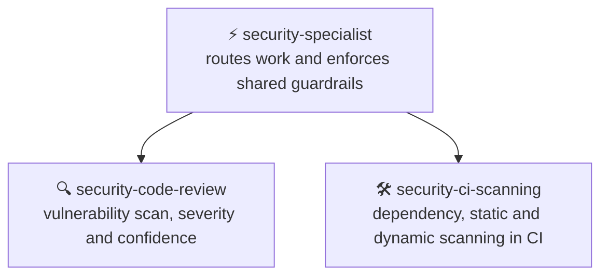

```
███████╗███████╗ ██████╗██╗   ██╗██████╗ ██╗████████╗██╗   ██╗
██╔════╝██╔════╝██╔════╝██║   ██║██╔══██╗██║╚══██╔══╝╚██╗ ██╔╝
███████╗█████╗  ██║     ██║   ██║██████╔╝██║   ██║    ╚████╔╝
╚════██║██╔══╝  ██║     ██║   ██║██╔══██╗██║   ██║     ╚██╔╝
███████║███████╗╚██████╗╚██████╔╝██║  ██║██║   ██║      ██║
╚══════╝╚══════╝ ╚═════╝ ╚═════╝ ╚═╝  ╚═╝╚═╝   ╚═╝      ╚═╝

███████╗██████╗ ███████╗ ██████╗██╗ █████╗ ██╗     ██╗███████╗████████╗
██╔════╝██╔══██╗██╔════╝██╔════╝██║██╔══██╗██║     ██║██╔════╝╚══██╔══╝
███████╗██████╔╝█████╗  ██║     ██║███████║██║     ██║███████╗   ██║
╚════██║██╔═══╝ ██╔══╝  ██║     ██║██╔══██║██║     ██║╚════██║   ██║
███████║██║     ███████╗╚██████╗██║██║  ██║███████╗██║███████║   ██║
╚══════╝╚═╝     ╚══════╝ ╚═════╝╚═╝╚═╝  ╚═╝╚══════╝╚═╝╚══════╝   ╚═╝
```

<div align="center">

# ⚡ Security Specialist

**Skills that reason about a codebase for vulnerabilities and set up automated security scanning in CI, for any agent.**

[](https://github.com/KinwiseNZ-DevOps/security-specialist/actions/workflows/validate.yml)
[](LICENSE)
[](https://agentskills.io)
[](https://agentskills.io/specification)
[](scripts/skills_tool.py)

</div>

Table of contents:

- [Skills](#skills)
- [How they fit together](#how-they-fit-together)
- [Install](#install)
- [Usage](#usage)
- [Optional agent profiles](#optional-agent-profiles)
- [Validate](#validate)
- [Layout](#layout)
- [Status and limits](#status-and-limits)

---

> [!IMPORTANT]
> **Principle: never auto-apply a security fix or scanning change, and never invent a finding, a credential, or a CVE that was not actually observed.**

These skills scan a codebase for vulnerabilities the way a security researcher would, and set up automated dependency, static and dynamic scanning in CI/CD. They are grounded in the OWASP Top 10 categories and common framework-specific anti-patterns, and follow the open [Agent Skills](https://agentskills.io/specification) format. They work in Claude Code, Codex, Cursor, Copilot, OpenCode, or any SKILL.md-compatible agent.

---

<a id="skills"></a>
## 🧩 Skills

<!-- catalogue:begin -->
| Skill | Purpose |
|---|---|
| [`security-ci-scanning`](skills/security-ci-scanning/SKILL.md) | Sets up automated security scanning in a CI/CD pipeline: dependency (SCA) audits, static (SAST) scanning, and dynamic (DAST) scanning of a running API or web app. |
| [`security-code-review`](skills/security-code-review/SKILL.md) | Reasons about a codebase for security vulnerabilities the way a security researcher would: tracing data flow, auditing dependencies and secrets, and reporting findings with severity and confidence. |
| [`security-specialist`](skills/security-specialist/SKILL.md) | Router and shared guardrails for application security work: reasoning about a codebase for vulnerabilities and setting up automated security scanning in CI/CD. |
<!-- catalogue:end -->

---

<a id="how-they-fit-together"></a>
## 🗺️ How they fit together



Most requests start at the router. A manual review usually comes first; automating it in CI comes once the team is happy with what it finds.

---

<a id="install"></a>
## 📦 Install

> [!TIP]
> Install the router skill **plus every sibling skill it links to**; routers reference siblings by relative path.

**Claude Code plugin** (installs the skills and any agent profiles together):

```text
/plugin marketplace add KinwiseNZ-DevOps/security-specialist
/plugin install security-specialist@security-specialist-marketplace
```
**ChatGPT desktop plugin** (local, skills and bundled hooks):

This repo has a portable `plugin.json` manifest and a repo marketplace at `.agents/plugins/marketplace.json`. Open this repo as a trusted project and restart ChatGPT desktop, then install **Security Specialist** from the Plugins Directory. Review and trust bundled hook scripts before they run.


Or copy or symlink the `skills/` subfolders you want into your agent's skills directory:

| Agent | Where skills live |
|---|---|
| Claude Code | `~/.claude/skills/` or a project's `.claude/skills/` |
| Codex · Cursor · Copilot · OpenCode · Windsurf | the agent's own SKILL.md discovery path |

To install supplied Claude Code, GitHub Copilot or Codex profiles into a project, run `python scripts/install_agents.py --host claude-code --target PATH`. Each repo supplies one main workflow agent and may supply one helper per host. Other hosts receive the skills only. If no profile files are supplied for that host, it makes no changes.

---

### Always on

In Claude Code, Security Specialist loads a short ruleset into every session as soon as the plugin is installed (never auto-apply a fix, rate severity and confidence separately, never guess a secret). It tells you its state at the start of each session and costs roughly 450 tokens.

| Mode | What it does |
|---|---|
| `on` (default) | The rules apply in every session |
| `auto` | The rules apply only in projects that look relevant: a `package.json` or `requirements.txt` is found |
| `off` | The rules do not load |

- Say **"stop security mode"** to pause it for the current session, and **"start security mode"** to resume.
- Ask Claude to **set the saved mode to on, off or auto**. It writes that word into `~/.claude/.security-specialist.mode`. You can also edit that file yourself, and deleting it returns to the default (`on`).
- It needs Node on the machine, because the start-up hook runs a small Node script. Without Node the hook quietly does nothing.
- Other agents have no start-up hook here. Paste `skills/security-specialist/references/always-on-rules.md` into that agent's instruction file instead.

### Safety checks

The same hooks run a few checks while you work. Each one only asks, warns or adds a reminder; none changes your files on its own.

| Check | What it does | On by default |
|---|---|---|
| `dangerGuard` | Asks before risky commands: force pushes, `git reset --hard`, `rm -r`, dropping data, `docker compose down -v`, publishing a package | Yes |
| `secretsGuard` | Asks before writing keys, tokens or `.env` files | Yes |
| `packageGuard` | Asks if a package about to be installed does not exist on PyPI, npm or pub.dev, because the name may be invented | Yes |
| `licenseGuard` | Warns after installing an npm or PyPI package with a GPL-family licence | Yes |
| `editSecurity` | Reminds Claude about risky code it just wrote: `eval`, SQL built from strings, unescaped HTML, tokens in SharedPreferences | Yes |
| `promptGuard` | Warns when pasted text looks like it is trying to steer the agent | Yes |
| `verifyReminder` | Tells you at the end of a turn if code changed but no tests, lint or analysis ran | Yes |
| `linkGuard` | Warns about links that return "not found" in Markdown, HTML and JSX files written | No |
| `styleGuard` | Warns when a reply is over 200 words or uses an em or en dash (built for AI Kiwiniser's style) | No |
| `sessionLog` | Writes tool names and file names, never content, to `~/.claude/logs/security-specialist/` | No |
| `autoCommit` | Saves tracked changes as a local commit at the end of a turn. It never pushes | No |

Switch any check with `~/.claude/.security-specialist.features.json`, for example `{"packageGuard": false, "sessionLog": true}`, or ask Claude to write it. The saved mode (on, off or auto) applies to every check. If several of these plugins are installed, each risky action is checked once, not once per plugin.

Privacy: `packageGuard` and `licenseGuard` send package names, and `linkGuard` sends the links it checks, to the public registry or site. Nothing else leaves your machine. Turn those checks off if that is a concern.

<a id="usage"></a>
## 🚀 Usage

> [!TIP]
> **You never need to memorise skill names.** Just describe the problem in plain words; the router picks the right skill automatically. But if you want short, reliable phrases that always work, use these:

**The flow** (this is all most people need):

```text
1. "Is this code secure?"                       → Scans and reports findings with severity and confidence
2. "Set up automated security scanning"          → Proposes CI scanning as a pull request
3. "Fix this SQL injection"                      → Reviews the specific code and proposes a patch to approve
```

**Short phrases that trigger each skill:**

| Just say… | What you get | Skill used |
|---|---|---|
| `Scan this repo for vulnerabilities` | A findings report with severity and confidence, grouped by category | *security-code-review* |
| `Check for exposed secrets or API keys` | A secrets and exposure scan, with safe placeholders correctly ignored | *security-code-review* |
| `Audit our dependencies for known CVEs` | A dependency audit against the vulnerable-package watchlist | *security-code-review* |
| `Add Dependabot/CodeQL/DAST scanning to our CI` | A pull request with the scanning workflow and a list of required secrets | *security-ci-scanning* |

> [!NOTE]
> Skills also trigger on their own when your request matches. In Claude Code you can also invoke one explicitly with `/<skill-name>`, but the plain phrases above are shorter and work across every agent.

---

<a id="optional-agent-profiles"></a>
## Optional agent profiles

This section applies only when agent definitions were supplied during setup. No agent profiles are supplied yet; all three skills run directly. See [AGENTS.md](AGENTS.md) for the dated note.

---

<a id="validate"></a>
## ✅ Validate

```bash
python scripts/skills_tool.py check
```

Checks: frontmatter, name/folder match, description length and trigger, body under 500 lines, every relative link resolves (including README.md and AGENTS.md), agent profile naming with no more than two profiles per host and exactly one `-workflow` main agent, agent `skills:` entries that exist and no `skills/<name>/SKILL.md` paths in agent bodies, plugin manifests (`.claude-plugin/plugin.json` and `marketplace.json`: required fields, licence matches `LICENSE`, `agents` lists every Claude Code profile, no top-level `agents/` folder), at least 3 eval cases per skill, catalogue freshness, no project-specific terms from `reference-content/strip-terms.txt`, and no em or en dashes in file names or in any text outside `reference-content/`. After the starter skill is deleted it also rejects leftover placeholders and setup-only paths that are tracked by Git or not ignored. Stdlib only, no dependencies.

---

<a id="layout"></a>
## 🗂️ Layout

<details>
<summary>Repository layout</summary>

```
skills/<name>/SKILL.md      one folder per skill (+ references/ where needed)
.claude-plugin/             plugin.json and marketplace.json (Claude Code plugin)
hooks/                      always-on rules and safety checks for Claude Code
evals/cases.jsonl           3+ behavioural cases per skill
resources/agents/             optional host profiles copied by installer
scripts/install_agents.py     copy optional agent profiles into a project
scripts/skills_tool.py      validate, regenerate catalogue (stdlib only)
.github/workflows/          CI runs `skills_tool.py check` (free on public repos)
AGENTS.md                   agent-facing rules for this repo
SETUP.md                    local checklist; ignored and kept off GitHub
reference-content/          private source material; ignored and kept off GitHub
templates/                  local skill scaffolding; ignored and kept off GitHub
```

</details>

---

<a id="status-and-limits"></a>
## 📌 Status and limits

> [!NOTE]
> - 20 October 2026: skills were authored from condensed, generalised security references (OWASP-style anti-patterns, a code-reasoning review workflow, and CI scanning setup guidance); none has been run against a real vulnerability yet. Reason: first draft awaiting real-world testing.
> - The vulnerable-package watchlist in `security-code-review` is a dated snapshot; check current advisories for anything it does not cover.
> - Licensed under MIT (see [LICENSE](LICENSE)).

---

<div align="center">

**⚡ Built on the [Agent Skills](https://agentskills.io) open format · grounded in the [OWASP Top 10](https://owasp.org/Top10/)**

</div>
