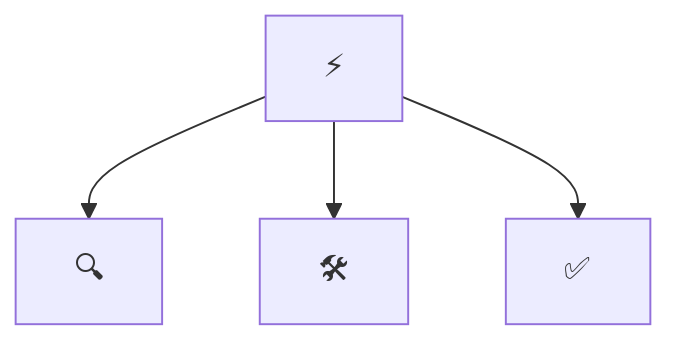

```
<Repo name rendered in the standard FIGlet ANSI Shadow font (pyfiglet "ansi_shadow"). One or two words per banner line, left-aligned with no indent, no trailing spaces, and no centring or widening.>
```

<div align="center">

# ⚡ <Repo Name>

**<One line: what these skills do, for whom>**

[](https://github.com/<OWNER>/<REPO>/actions/workflows/validate.yml)
[](LICENSE)
[](https://agentskills.io)
[](https://agentskills.io/specification)
[](scripts/skills_tool.py)

</div>

Table of contents:

- [Skills](#skills)
- [How they fit together](#how-they-fit-together)
- [Install](#install)
- [Usage](#usage)
- [Optional agent profiles](#optional-agent-profiles)
- [Validate](#validate)
- [Layout](#layout)
- [Status and limits](#status-and-limits)

---

> [!IMPORTANT]
> **Principle: <the single sentence every skill in this repo must obey.>**

<Two or three sentences: what problems the skills solve, what they are grounded in (official docs or authoritative sources), and that they follow the open [Agent Skills](https://agentskills.io/specification) format. Name the agents they work in, e.g. Claude Code, Codex, Cursor, Copilot, OpenCode, or any SKILL.md-compatible agent.>

---

<a id="skills"></a>
## 🧩 Skills

<!-- catalogue:begin -->
| Skill | Purpose |
|---|---|
| [`example-skill`](skills/example-skill/SKILL.md) | Placeholder skill demonstrating this repository's skill format: the gate, steps, hard rule phrasing and reference layout. |
<!-- catalogue:end -->

---

<a id="how-they-fit-together"></a>
## 🗺️ How they fit together



<One sentence on the order or priority in which the skills usually apply. Delete this section and the diagram for a repo with a single skill.>

---

<a id="install"></a>
## 📦 Install

> [!TIP]
> Install the router skill **plus every sibling skill it links to**; routers reference siblings by relative path.

**Claude Code plugin** (installs the skills and any agent profiles together):

```text
/plugin marketplace add <OWNER>/<REPO>
/plugin install <PLUGIN-NAME>@<MARKETPLACE-NAME>
```

Or copy or symlink the `skills/` subfolders you want into your agent's skills directory:

| Agent | Where skills live |
|---|---|
| Claude Code | `~/.claude/skills/` or a project's `.claude/skills/` |
| Codex · Cursor · Copilot · OpenCode · Windsurf | the agent's own SKILL.md discovery path |

To install supplied Claude Code, GitHub Copilot or Codex profiles into a project, run `python scripts/install_agents.py --host claude-code --target PATH`. Each repo supplies one main workflow agent and may supply one helper per host. Other hosts receive the skills only. If no profile files are supplied for that host, it makes no changes.

---

### Always on

In Claude Code, Example Skills loads a short ruleset into every session as soon as the plugin is installed (replace this with one line on what the rules enforce). It tells you its state at the start of each session and costs roughly 450 tokens.

| Mode | What it does |
|---|---|
| `on` (default) | The rules apply in every session |
| `auto` | The rules apply only in projects that look relevant: the project files named in `autoMarkers` |
| `off` | The rules do not load |

- Say **"stop example mode"** to pause it for the current session, and **"start example mode"** to resume.
- Ask Claude to **set the saved mode to on, off or auto**. It writes that word into `~/.claude/.example-skills.mode`. You can also edit that file yourself, and deleting it returns to the default (`on`).
- It needs Node on the machine, because the start-up hook runs a small Node script. Without Node the hook quietly does nothing.
- Other agents have no start-up hook here. Paste `skills/example-skill/references/always-on-rules.md` into that agent's instruction file instead.

### Safety checks

The same hooks run a few checks while you work. Each one only asks, warns or adds a reminder; none changes your files on its own.

| Check | What it does | On by default |
|---|---|---|
| `dangerGuard` | Asks before risky commands: force pushes, `git reset --hard`, `rm -r`, dropping data, `docker compose down -v`, publishing a package | Yes |
| `secretsGuard` | Asks before writing keys, tokens or `.env` files | Yes |
| `packageGuard` | Asks if a package about to be installed does not exist on PyPI, npm or pub.dev, because the name may be invented | Yes |
| `licenseGuard` | Warns after installing an npm or PyPI package with a GPL-family licence | Yes |
| `editSecurity` | Reminds Claude about risky code it just wrote: `eval`, SQL built from strings, unescaped HTML, tokens in SharedPreferences | Yes |
| `promptGuard` | Warns when pasted text looks like it is trying to steer the agent | Yes |
| `verifyReminder` | Tells you at the end of a turn if code changed but no tests, lint or analysis ran | Yes |
| `linkGuard` | Warns about links that return "not found" in Markdown, HTML and JSX files written | No |
| `styleGuard` | Warns when a reply is over 200 words or uses an em or en dash (built for AI Kiwiniser's style) | No |
| `sessionLog` | Writes tool names and file names, never content, to `~/.claude/logs/example-skills/` | No |
| `autoCommit` | Saves tracked changes as a local commit at the end of a turn. It never pushes | No |

Switch any check with `~/.claude/.example-skills.features.json`, for example `{"packageGuard": false, "sessionLog": true}`, or ask Claude to write it. The saved mode (on, off or auto) applies to every check. If several of these plugins are installed, each risky action is checked once, not once per plugin.

Privacy: `packageGuard` and `licenseGuard` send package names, and `linkGuard` sends the links it checks, to the public registry or site. Nothing else leaves your machine. Turn those checks off if that is a concern.

<a id="usage"></a>
## 🚀 Usage

> [!TIP]
> **You never need to memorise skill names.** Just describe the problem in plain words; the router picks the right skill automatically. But if you want short, reliable phrases that always work, use these:

**The flow** (this is all most people need):

```text
1. "<first phrase>"     → <what happens>
2. "<second phrase>"    → <what happens>
3. "<third phrase>"     → <what happens>
```

**Short phrases that trigger each skill:**

| Just say… | What you get | Skill used |
|---|---|---|
| `<short plain phrase>` | <what happens> | *<skill>* |

> [!NOTE]
> Skills also trigger on their own when your request matches. In Claude Code you can also invoke one explicitly with `/<skill-name>`, but the plain phrases above are shorter and work across every agent.

---

<a id="optional-agent-profiles"></a>
## Optional agent profiles

This section applies only when agent definitions were supplied during setup. One main agent handles the repo's workflows through named modes, and an optional helper handles one distinct task. Profiles live under `resources/agents/<host>/`. Other hosts receive the skills only. If no agents were supplied, remove this section and let the skills run directly.

---

<a id="validate"></a>
## ✅ Validate

```bash
python scripts/skills_tool.py check
```

Checks: frontmatter, name/folder match, description length and trigger, body under 500 lines, every relative link resolves (including README.md and AGENTS.md), agent profile naming with no more than two profiles per host and exactly one `-workflow` main agent, agent `skills:` entries that exist and no `skills/<name>/SKILL.md` paths in agent bodies, plugin manifests (`.claude-plugin/plugin.json` and `marketplace.json`: required fields, licence matches `LICENSE`, `agents` lists every Claude Code profile, no top-level `agents/` folder), at least 3 eval cases per skill, catalogue freshness, no project-specific terms from `reference-content/strip-terms.txt`, and no em or en dashes in file names or in any text outside `reference-content/`. After the starter skill is deleted it also rejects leftover placeholders and setup-only paths that are tracked by Git or not ignored. Stdlib only, no dependencies.

---

<a id="layout"></a>
## 🗂️ Layout

<details>
<summary>Repository layout</summary>

```
skills/<name>/SKILL.md      one folder per skill (+ references/ where needed)
.claude-plugin/             plugin.json and marketplace.json (Claude Code plugin)
hooks/                      always-on rules and safety checks for Claude Code
evals/cases.jsonl           3+ behavioural cases per skill
resources/agents/             optional host profiles copied by installer
scripts/install_agents.py     copy optional agent profiles into a project
scripts/skills_tool.py      validate, regenerate catalogue (stdlib only)
.github/workflows/          CI runs `skills_tool.py check` (free on public repos)
AGENTS.md                   agent-facing rules for this repo
SETUP.md                    local checklist; ignored and kept off GitHub
reference-content/          private source material; ignored and kept off GitHub
templates/                  local skill scaffolding; ignored and kept off GitHub
```

</details>

---

<a id="status-and-limits"></a>
## 📌 Status and limits

> [!NOTE]
> - <Known limits, each dated, mirroring the "Known deliberate states" section of AGENTS.md.>
> - Licensed under MIT (see [LICENSE](LICENSE)).

---

<div align="center">

**⚡ Built on the [Agent Skills](https://agentskills.io) open format · grounded in <link to the official docs or sources>**

</div>
